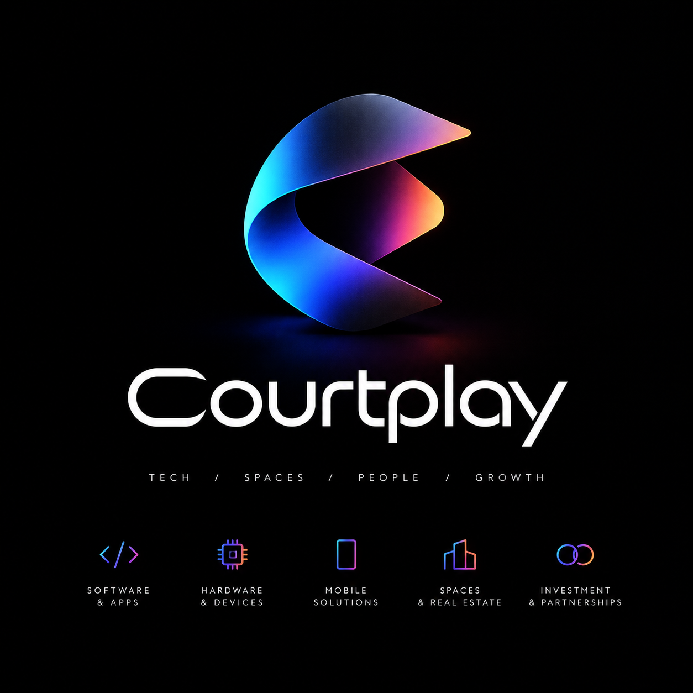
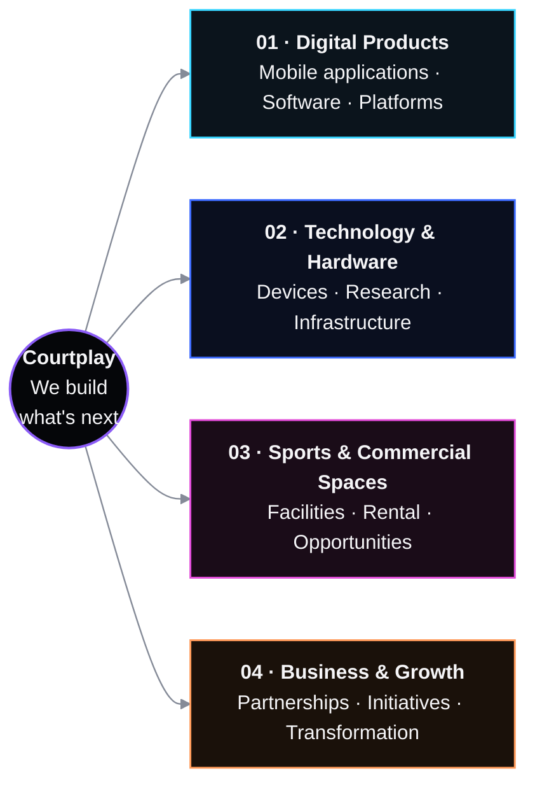

  

  

### We build what's next.

<b>INNOVATION</b> &nbsp;·&nbsp; <b>TECHNOLOGY</b> &nbsp;·&nbsp; <b>SPACES</b>

 

 

 

## Technology is only the beginning.

We believe in **ideas** that become **products**, in technology that solves **real problems**, and in **spaces** that create **new possibilities**.

Courtplay connects technology, digital product development and sports and commercial spaces to explore new business opportunities. We develop technology, create digital experiences and connect spaces with new opportunities for growth.

**TECH** &nbsp;/&nbsp; **SPACES** &nbsp;/&nbsp; **PEOPLE** &nbsp;/&nbsp; **GROWTH**

 

## One vision. Multiple possibilities.

Four lines of activity, connected by a single way of working.

| &nbsp; | Line | What we do |
|:---:|:---|:---|
| **01** | **Digital Products** | We turn ideas into digital products through mobile applications, interactive platforms and software solutions designed to meet real needs. Mobile applications · Software development · Digital platforms · Product innovation |
| **02** | **Technology & Hardware** | We explore and develop technology solutions that connect devices, systems and digital experiences. Hardware solutions · Technology research · Digital infrastructure · Connected experiences |
| **03** | **Sports & Commercial Spaces** | We connect physical spaces with new ways of using, managing and operating them, creating opportunities in sports and commercial environments. Sports facilities · Commercial spaces · Space rental · Facility opportunities |
| **04** | **Business & Growth** | We drive initiatives that connect technology, operations and spaces to open new possibilities for collaboration and growth. Business initiatives · Strategic partnerships · Digital transformation · New opportunities |

 

## Built to connect. Designed to evolve.

Three principles shape how we think, build and grow.

| 01 · Think beyond | 02 · Build with purpose | 03 · Create opportunities |
|:---|:---|:---|
| We research possibilities and explore new ways of solving problems. | We turn ideas into solutions that are useful, functional and ready to evolve. | We connect technology, people and spaces to generate new opportunities. |

 

## From digital experiences to real-world spaces.

From a mobile app to a sports or commercial space, Courtplay explores how technology and physical environments can complement each other to create better experiences and new opportunities.

 

## Better together.

We're looking to connect with companies, professionals and partners who share a vision of innovation, collaboration and growth.

- **Technology partnerships**
- **Business opportunities**
- **Sports & commercial spaces**

 

## Have something in mind?

Great ideas start with a conversation. Tell us what you want to build, develop or explore.

**[Start a conversation →](https://courtplay.es/#contact)**

 

<b>Leer en español</b>

 

**Technology is only the beginning.** Creemos en las **ideas** que se convierten en **productos**, en la tecnología que resuelve **problemas reales** y en los espacios que generan **nuevas posibilidades**.

Desarrollamos tecnología, creamos experiencias digitales y conectamos espacios con nuevas oportunidades de crecimiento.

**Qué hacemos.** Cuatro líneas de actividad, unidas por una misma forma de trabajar:

- **01 · Productos digitales.** Transformamos ideas en productos digitales mediante aplicaciones móviles, plataformas interactivas y soluciones de software diseñadas para resolver necesidades reales.
- **02 · Tecnología y hardware.** Exploramos y desarrollamos soluciones tecnológicas que conectan dispositivos, sistemas y experiencias digitales.
- **03 · Espacios deportivos y comerciales.** Conectamos espacios físicos con nuevas formas de uso, gestión y explotación, creando oportunidades en entornos deportivos y comerciales.
- **04 · Negocio y crecimiento.** Impulsamos iniciativas que conectan tecnología, operaciones y espacios para abrir nuevas posibilidades de colaboración y crecimiento.

**Better together.** Buscamos conectar con empresas, profesionales y socios que compartan una visión de innovación, colaboración y crecimiento.

**[Hablemos →](https://courtplay.es/#contact)**

 

  

<b>Technology. Spaces. Possibilities.</b>
 
<a href="https://courtplay.es">courtplay.es</a> &nbsp;·&nbsp; © Courtplay. All rights reserved.

